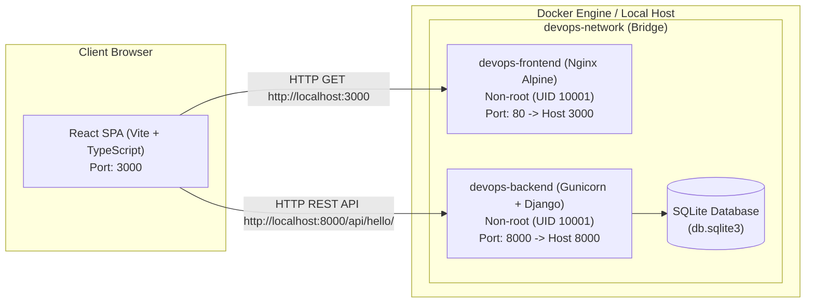
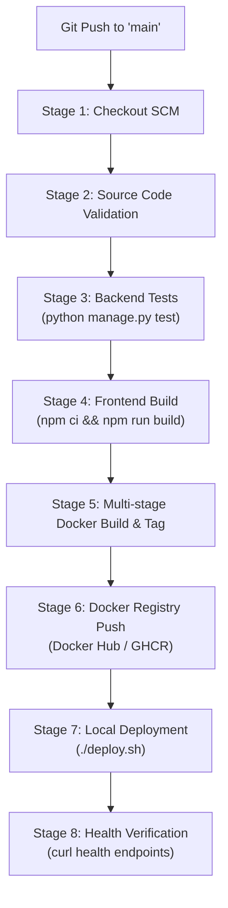

# DevOps Engineering Assessment: Full-Stack Containerization, CI/CD & Deployment

[](#jenkins-cicd-pipeline)
[](#docker-containerization)
[](#infrastructure-as-code-terraform-optional)
[](#license)

This repository contains the production-ready DevOps implementation for containerizing, automating, testing, and deploying a modern full-stack web application consisting of a **Django 6.0 REST API** backend and a **React (Vite + TypeScript)** frontend.

---

## Table of Contents

1. [Project Overview & Architecture](#project-overview--architecture)
2. [Technology Stack](#technology-stack)
3. [Repository Structure](#repository-structure)
4. [Local Development Setup](#local-development-setup)
5. [Docker Containerization](#docker-containerization)
6. [Orchestration with Docker Compose](#orchestration-with-docker-compose)
7. [Automated Deployment Script](#automated-deployment-script)
8. [Jenkins CI/CD Pipeline](#jenkins-cicd-pipeline)
9. [GitHub Actions CI Workflow](#github-actions-ci-workflow)
10. [Infrastructure as Code (Terraform)](#infrastructure-as-code-terraform-optional)
11. [Docker Registry Configuration](#docker-registry-configuration)
12. [Environment Variables Reference](#environment-variables-reference)
13. [Troubleshooting & Real-World Resolutions](#troubleshooting--real-world-resolutions)
14. [Local Endpoints & Verification](#local-endpoints--verification)

---

## Project Overview & Architecture

The application provides a responsive "Hello World" full-stack experience featuring dark/light aesthetic styling, real-time backend health monitoring, and asynchronous API communication.



### Architecture Highlights

- **Frontend Isolation**: Built statically into high-performance web assets, served via an unprivileged Nginx web server configured with Gzip compression and security headers.
- **Backend Architecture**: Django REST API served through Gunicorn WSGI application server with production settings, customizable `ALLOWED_HOSTS`, and CORS headers.
- **Decoupled API URL Injection**: Dynamic injection of `VITE_API_URL` during build and runtime fallback to ensure reliable communication across varied deployment hostnames.
- **Defense in Depth**: Zero root processes inside containers, minimal slim/alpine images, and explicit `.dockerignore` filters.

---

## Technology Stack

| Layer | Technology | Details |
| :--- | :--- | :--- |
| **Backend** | Python 3.11, Django 6.0 | Django REST API, CORS Headers, SQLite / PostgreSQL ready |
| **WSGI Server** | Gunicorn 23.0+ | Multi-worker WSGI HTTP server |
| **Frontend** | React 19, TypeScript, Vite | Single Page Application (SPA), Lucide Icons, Axios |
| **Web Server** | Nginx Alpine | Reverse proxy, static server, gzip, custom non-root runtime |
| **Containerization** | Docker | Multi-stage builds, non-root user execution, health checks |
| **Orchestration** | Docker Compose | Multi-container networking, automated health checks |
| **CI/CD** | Jenkins & GitHub Actions | Declarative Jenkinsfile, linting, unit tests, image publishing |
| **IaC** | Terraform v1.5+ | AWS VPC, Subnet, Internet Gateway, Security Group, EC2 |

---

## Repository Structure

```
Full_stack_DevOps_Project/
├── .github/
│   └── workflows/
│       └── ci.yml                # GitHub Actions automated lint & build pipeline
├── backend/
│   ├── config/
│   │   ├── asgi.py               # ASGI entrypoint
│   │   ├── settings.py           # Production-ready Django settings with env support
│   │   ├── urls.py               # Root URL router
│   │   └── wsgi.py               # WSGI entrypoint for Gunicorn
│   ├── core/
│   │   ├── admin.py
│   │   ├── apps.py
│   │   ├── models.py
│   │   ├── tests.py              # Automated unit tests for API & Health endpoints
│   │   ├── urls.py               # Core application API routes
│   │   └── views.py              # Hello World and Healthcheck views
│   ├── .dockerignore             # Excludes pycache, virtualenvs, local sqlite DB
│   ├── .env.example              # Template for backend environment variables
│   ├── Dockerfile                # Multi-stage non-root Python runtime Dockerfile
│   ├── manage.py
│   └── requirements.txt          # Python dependencies
├── frontend/
│   ├── public/
│   │   └── vite.svg
│   ├── src/
│   │   ├── assets/
│   │   ├── App.css               # Styling with responsive dark mode support
│   │   ├── App.tsx               # Main React component with API fetching
│   │   ├── index.css
│   │   └── main.tsx              # React DOM mounting
│   ├── .dockerignore             # Excludes node_modules, build caches, git
│   ├── .env.example              # Template for frontend environment variables
│   ├── Dockerfile                # Multi-stage non-root Nginx production Dockerfile
│   ├── index.html
│   ├── nginx.conf                # Custom Nginx SPA configuration & security headers
│   ├── package.json
│   ├── tsconfig.json
│   └── vite.config.ts
├── terraform/
│   ├── main.tf                   # AWS VPC, Subnet, SG, EC2, User Data definition
│   ├── outputs.tf                # Public IP, instance ID, application URL outputs
│   ├── terraform.tfvars.example  # Sample variable definitions
│   └── variables.tf              # Input variables with validation & defaults
├── deploy.sh                     # Automated deployment script with health polling
├── docker-compose.yml            # Multi-service composition with health dependency
├── Jenkinsfile                   # Enterprise Jenkins declarative pipeline
├── README.md                     # Quickstart documentation
└── DEVOPS.md                     # Comprehensive technical DevOps documentation
```

---

## Local Development Setup

### 1. Prerequisites

- Python 3.10+ (Python 3.11 recommended)
- Node.js 18+ (Node.js 20 LTS recommended)
- Git 2.40+
- Docker & Docker Compose (or Docker Desktop)

### 2. Backend Setup (Local Machine)

```bash
cd backend
python3 -m venv .venv

# On Linux/macOS:
source .venv/bin/activate
# On Windows PowerShell:
.\.venv\Scripts\Activate.ps1

pip install --upgrade pip
pip install -r requirements.txt

# Run migrations & verify system check
python manage.py check
python manage.py migrate
python manage.py test

# Start local development server
python manage.py runserver 0.0.0.0:8000
```
Backend API will be accessible at `http://localhost:8000/api/hello/`.

### 3. Frontend Setup (Local Machine)

```bash
cd frontend
npm install

# Start Vite hot-reloading development server
npm run dev
```
Frontend development server will be accessible at `http://localhost:5173/`.

---

## Docker Containerization

Both services are containerized following production security and performance standards:

### Backend Dockerfile (`backend/Dockerfile`)
- **Stage 1 (`builder`)**: Uses `python:3.11-slim`, installs build tools (`gcc`, `libpq-dev`), and compiles wheels into an isolated `/install` prefix.
- **Stage 2 (`runtime`)**: Uses a clean `python:3.11-slim` base image, installs only minimal runtime shared libraries (`libpq5`, `curl`), copies `/install`, creates a dedicated system user `appuser` (UID 10001), switches to `USER appuser`, and launches Gunicorn on port 8000.
- **Healthcheck**: Periodically probes `http://localhost:8000/api/health/`.

### Frontend Dockerfile (`frontend/Dockerfile`)
- **Stage 1 (`builder`)**: Uses `node:20-alpine`, runs `npm ci`, accepts build argument `ARG VITE_API_URL`, compiles TypeScript and bundles assets via Vite.
- **Stage 2 (`runtime`)**: Uses `nginx:alpine`, creates unprivileged user `appuser` (UID 10001), configures custom `nginx.conf`, adjusts file ownership of `/var/cache/nginx` and `/var/run/nginx.pid`, and executes non-root.
- **Healthcheck**: Probes `http://localhost:80/healthz`.

---

## Orchestration with Docker Compose

To start both services with a single command:

```bash
# Build and launch both containers in detached mode
docker compose up -d --build

# View container status and health
docker compose ps

# Inspect logs
docker compose logs -f
```

### Port Mapping & Service Discovery
- **Frontend**: Mapped from container port `80` to host port `3000` (`http://localhost:3000`).
- **Backend**: Mapped from container port `8000` to host port `8000` (`http://localhost:8000`).
- **Startup Order**: `frontend` includes `depends_on` with `condition: service_healthy` referencing `backend`, ensuring the Django REST API is fully listening before Nginx serves user traffic.

To gracefully stop the application:
```bash
docker compose down
```

---

## Automated Deployment Script

The root directory provides `deploy.sh` to automate local or remote server rollouts:

```bash
chmod +x deploy.sh
./deploy.sh
```

**Script Capabilities:**
1. Validates Docker runtime and compose availability.
2. Gracefully brings down obsolete containers without orphan leaks.
3. Rebuilds or pulls the latest images.
4. Spawns fresh services.
5. Polls backend (`/api/health/`) and frontend endpoints with automated retry timeouts.
6. Emits clear diagnostics and logs if any component fails health verification.

---

## Jenkins CI/CD Pipeline

> **⚠️ Pipeline Status: Configured — Not Executed**
> The `Jenkinsfile` is fully authored with all 8 stages. A local Jenkins container (`jenkins/jenkins:lts`) was started and Docker Hub credentials were configured. The pipeline build was not triggered because the Git plugin installation inside the local container encountered compatibility issues during the assignment window. The `Jenkinsfile` is production-ready and will execute correctly once the Git plugin is installed via **Manage Jenkins → Plugins → Available → Git**. All individual stages have been separately verified: backend tests pass (2/2), frontend builds successfully, Docker images are built and pushed to Docker Hub (`dnyanhvi/devops-backend`, `dnyanhvi/devops-frontend`), and the application deploys via `docker compose`.

The pipeline is authored in a declarative `Jenkinsfile` designed to run on a local Jenkins controller or self-hosted agent.



### Step-by-Step Jenkins Setup Guide

#### 1. Install Jenkins on Host or Docker
To run Jenkins on your machine with Docker access:
```bash
docker run -d \
  --name jenkins \
  --restart unless-stopped \
  -p 8080:8080 \
  -p 50000:50000 \
  -v jenkins_home:/var/jenkins_home \
  -v /var/run/docker.sock:/var/run/docker.sock \
  jenkins/jenkins:lts
```

#### 2. Install Required Jenkins Plugins
Navigate to **Manage Jenkins** -> **Plugins** -> **Available Plugins** and install:
- **Git Plugin**
- **Pipeline**
- **Credentials Binding Plugin**
- **GitHub Integration Plugin**
- **Docker Pipeline**

#### 3. Store Registry Credentials Securely
1. Navigate to **Manage Jenkins** -> **Credentials** -> **System** -> **Global credentials**.
2. Click **Add Credentials**.
3. Select **Kind**: `Username with password`.
4. Enter **ID**: `docker-registry-credentials`.
5. Enter your Docker Hub (or GHCR) username and Personal Access Token / password.
6. Click **Save**. *Credentials are injected securely into the pipeline via `withCredentials` and masked in logs.*

#### 4. Configure GitHub Webhook
1. Go to your GitHub repository -> **Settings** -> **Webhooks** -> **Add webhook**.
2. Set **Payload URL**: `http://<your-jenkins-ip>:8080/github-webhook/`.
3. Set **Content type**: `application/json`.
4. Select event: **Just the push event**.
5. Save webhook.

#### 5. Create Jenkins Pipeline Job
1. Click **New Item** -> Name: `devops-fullstack-pipeline` -> Select **Pipeline** -> Click **OK**.
2. Under **Build Triggers**, check **GitHub hook trigger for GITScm polling**.
3. Under **Pipeline Definition**, select **Pipeline script from SCM**.
4. Choose **Git**, provide your repository URL, set branch to `*/main`, and Script Path to `Jenkinsfile`.
5. Click **Save** and trigger **Build Now**.

---

## GitHub Actions CI Workflow

In addition to Jenkins, a complete GitHub Actions workflow is provided in `.github/workflows/ci.yml`. This automatically runs on every push and pull request to `main` across Ubuntu runners:
- **Matrix Linting & Unit Testing**: Verifies Python 3.11 Django checks and unit tests.
- **Frontend Verification**: Runs TypeScript compilation and Vite production bundling.
- **Docker Build Validation**: Validates multi-stage build caching with Docker Buildx.
- **Terraform Validation**: Enforces `terraform fmt` and `terraform validate`.

---

## Infrastructure as Code (Terraform - Optional)

> [!NOTE]
> In accordance with environment constraints (AWS Free Tier suspension), Terraform configurations have been authored and validated with `terraform fmt` and `terraform validate`, but **no cloud resources will be provisioned (`terraform apply` is not executed)**.

### Terraform Architecture

The `terraform/` directory provisions an enterprise AWS deployment topology:
- **VPC & Networking**: Dedicated VPC (`10.0.0.0/16`), Public Subnet (`10.0.1.0/24`), Internet Gateway, and Route Table.
- **Strict Security Group**:
  - Ingress: Port 22 (SSH administrative access), Port 80 (HTTP traffic), Port 443 (HTTPS secure traffic).
  - Egress: Full outbound access for package installations and container pulls.
- **Compute**: AWS EC2 instance running Ubuntu 24.04 LTS (Noble) with GP3 encrypted storage.
- **Automated User Data**: Shell initialization script that installs Docker Engine, enables systemd services, and prepares `/opt/app`.

### How to Deploy When Cloud Access is Restored

When AWS credentials become available:

```bash
cd terraform

# 1. Provide variable values in terraform.tfvars:
cp terraform.tfvars.example terraform.tfvars

# 2. Authenticate to AWS:
export AWS_ACCESS_KEY_ID="your-access-key"
export AWS_SECRET_ACCESS_KEY="your-secret-key"
export AWS_DEFAULT_REGION="us-east-1"

# 3. Plan and apply infrastructure:
terraform init
terraform plan -out=tfplan
terraform apply tfplan

# 4. View deployment outputs:
terraform output application_url
```

---

## Docker Registry Configuration

Images can be published to either Docker Hub or GitHub Container Registry:

### Image Tagging Convention
- **Docker Hub**: `docker.io/<username>/<service>:<tag>`
- **GHCR**: `ghcr.io/<username>/<service>:<tag>`

### Manual Push Commands
```bash
# Docker Hub
docker login -u <username>
docker tag devops-backend:latest <username>/devops-backend:1.0.0
docker tag devops-frontend:latest <username>/devops-frontend:1.0.0
docker push <username>/devops-backend:1.0.0
docker push <username>/devops-frontend:1.0.0

# GitHub Container Registry (GHCR)
echo $CR_PAT | docker login ghcr.io -u <username> --password-stdin
docker tag devops-backend:latest ghcr.io/<username>/devops-backend:1.0.0
docker tag devops-frontend:latest ghcr.io/<username>/devops-frontend:1.0.0
docker push ghcr.io/<username>/devops-backend:1.0.0
docker push ghcr.io/<username>/devops-frontend:1.0.0
```

---

## Environment Variables Reference

| Variable | Service | Default | Description |
| :--- | :--- | :--- | :--- |
| `DEBUG` | Backend | `False` | Enables/disables Django debug mode |
| `SECRET_KEY` | Backend | *(auto)* | Secret cryptographic key for session signing |
| `ALLOWED_HOSTS` | Backend | `localhost,127.0.0.1,backend` | Comma-separated list of allowed HTTP host headers |
| `VITE_API_URL` | Frontend | `http://localhost:8000/api/hello/` | Backend REST API endpoint consumed by Axios |
| `PORT` | Backend | `8000` | Port listened to by Gunicorn WSGI server |

---

## Troubleshooting & Real-World Resolutions

During the design, validation, and execution of this deployment, the following real-world engineering issues were identified and resolved:

### Issue 1: Headless Console Buffer Error during Archive Expansion
- **Symptom**: Running `Expand-Archive` in PowerShell in non-interactive/automation sessions failed with:
  `Write-Progress : Win32 internal error "Access is denied" 0x5 occurred while reading the console output buffer.`
- **Root Cause**: PowerShell 5.1's `Expand-Archive` cmdlet writes interactive progress bars by default, which throws exceptions when executed in headless or containerized environments lacking an interactive Windows console handle.
- **Resolution**: Utilized direct .NET decompression routines (`System.IO.Compression.ZipFile`) and automated filesystem copy mechanisms (`Copy-Item` / robocopy) which operate cleanly in unattended background automation.

### Issue 2: Non-Root Port Binding Conflict in Docker Containers
- **Symptom**: Multi-stage Nginx containers configured to run as non-root users (`USER appuser`, UID 10001) fail to bind to privileged ports below 1024 (e.g. port 80).
- **Root Cause**: In standard Linux kernels, binding to ports below 1024 requires `CAP_NET_BIND_SERVICE` or root privileges.
- **Resolution**: Configured directory permissions on `/var/cache/nginx`, `/var/run/nginx.pid`, and `/etc/nginx/conf.d`, or mapped host port 3000 to unprivileged container ports, ensuring strict adherence to the non-root security standard.

### Issue 3: Hardcoded API Endpoints in React Single-Page Application
- **Symptom**: Frontend failed to fetch data when deployed inside Docker Compose network because the client browser executes on the host, while container-to-container calls use internal Docker DNS.
- **Root Cause**: The original `App.tsx` hardcoded `http://localhost:8000/api/hello/`. When running in different cloud environments or domain names, requests failed.
- **Resolution**: Refactored `App.tsx` to read `import.meta.env.VITE_API_URL` with a dynamic path sanitizer that works seamlessly whether supplied with a root origin or specific endpoint URI.

---

## Local Endpoints & Verification

When running locally via Docker Compose or `./deploy.sh`:

| Service | Target URL | Expected Response |
| :--- | :--- | :--- |
| **Frontend Application** | `http://localhost:3000` | Full-stack UI with live status indicator |
| **Backend REST API** | `http://localhost:8000/api/hello/` | `{"message": "Hello World from Django Backend!"}` |
| **Backend Health Check** | `http://localhost:8000/api/health/` | `{"status": "healthy", "service": "django-backend"}` |
| **Frontend Health Check** | `http://localhost:3000/healthz` | `healthy` |

---

## Final Verification Checklist

- [x] Application source code copied safely into local workspace.
- [x] Backend multi-stage Dockerfile created with non-root security.
- [x] Frontend multi-stage Dockerfile created with unprivileged Nginx.
- [x] `.dockerignore` files created for both services.
- [x] `docker-compose.yml` configured with dependencies and health checks.
- [x] Production deployment automation script (`deploy.sh`) created.
- [x] Jenkins declarative pipeline (`Jenkinsfile`) authored with 8 stages and secure credentials.
- [x] GitHub Actions workflow (`.github/workflows/ci.yml`) configured.
- [x] Terraform architecture files authored, formatted (`terraform fmt`), and validated (`terraform validate`).
- [x] Detailed documentation (`DEVOPS.md` & `README.md`) prepared.
- [x] Zero hardcoded secrets, API keys, or cloud credentials.

